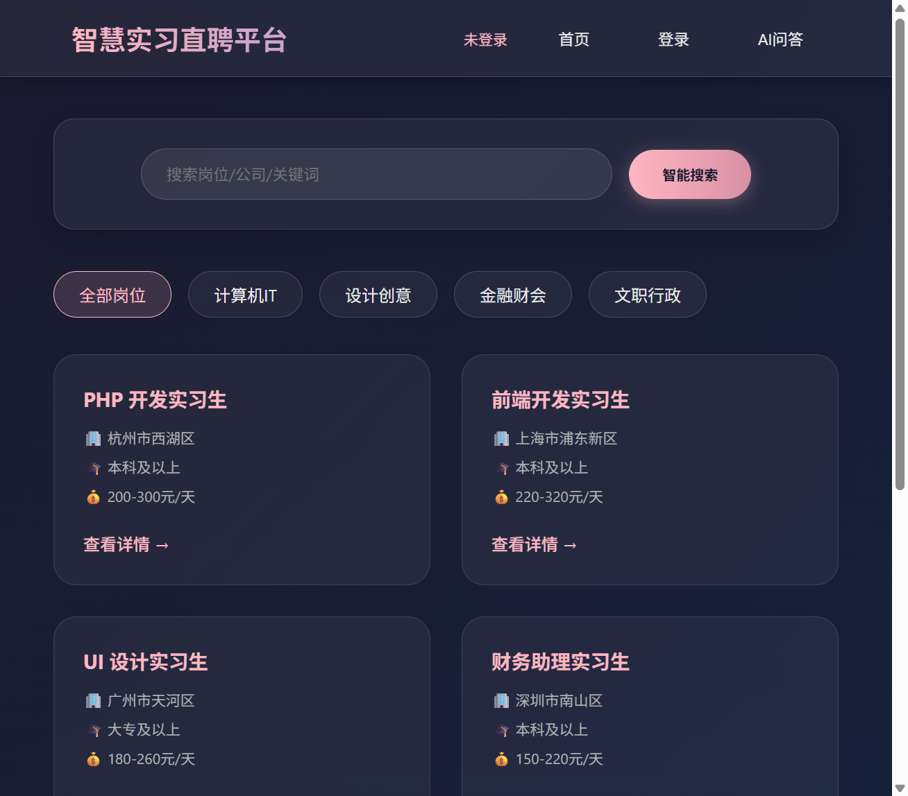
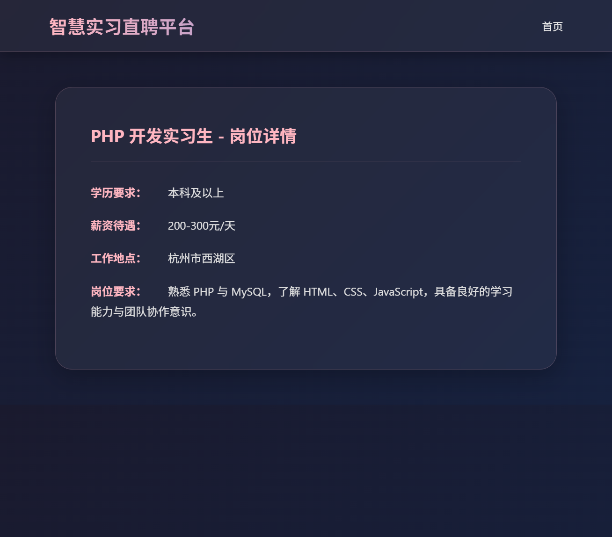

# 智慧实习直聘平台

基于 PHP、MySQL 与原生 JavaScript 开发的实习岗位信息平台，包含用户登录注册、岗位浏览与筛选、实习信息管理及 AI 问答功能。本项目为动态网页课程设计作品。

## 功能说明

### 用户模块
- 注册：校验用户名、QQ 邮箱、密码及确认密码
- 登录：校验用户名与密码，并保存登录状态
- 退出登录：清除 localStorage、Cookie 与 Session
- 游客模式：可浏览和筛选岗位，查看详情前需先登录

### 实习岗位模块
- 岗位浏览：展示岗位名称、类别、薪资、学历和工作地址
- 搜索筛选：支持关键词搜索与岗位分类筛选
- 岗位详情：登录后查看岗位要求等完整信息

### 实习信息管理模块
- 添加岗位：录入岗位、薪资、学历、地址和要求
- 修改岗位：回填原有信息并保存修改
- 删除岗位：按岗位编号删除，操作前二次确认
- 岗位列表：展示全部岗位，操作后自动刷新

### AI 问答模块
- 通过智谱 AI GLM-4-Flash 解答实习相关问题

## 项目截图

### 首页



### 登录与注册


### 实习信息管理


### 岗位详情



### AI 问答


截图中的岗位数据为演示数据。

## 技术栈

| 项目 | 说明 |
| --- | --- |
| 前端 | HTML、CSS、原生 JavaScript |
| 后端 | PHP 7 及以上 |
| 数据库 | MySQL、mysqli |
| 前后端交互 | Fetch API、JSON |
| 登录状态 | Session、Cookie、localStorage |
| AI 接口 | 智谱 AI GLM-4-Flash |
| 开发环境 | phpStudy、Apache |

## 项目结构

```text
smart-intern-platform/
├── index.html          # 首页
├── index1.php          # 首页岗位列表接口
├── login.html          # 登录页面
├── login.php           # 登录接口
├── register.html       # 注册页面
├── register.php        # 注册接口
├── detail.html         # 岗位详情页面
├── detail.php          # 岗位详情接口
├── manage.html         # 实习信息管理页面
├── manage.php          # 实习信息增删改查接口
├── ai.html             # AI 问答页面
├── ai.php              # AI 问答接口
├── logout.php          # 退出登录接口
├── config.php          # 数据库配置
├── screenshots/        # 项目截图
├── .env                # 本地敏感配置，不上传 GitHub
├── .gitignore
└── README.md
```

## 运行方式

### 1. 准备环境

启动 phpStudy 中的 Apache 和 MySQL，PHP 需启用 mysqli、curl 扩展。将项目放入 phpStudy 的网站目录。

### 2. 初始化数据库

在 MySQL 中执行：

```sql
CREATE DATABASE IF NOT EXISTS `database` DEFAULT CHARACTER SET utf8mb4;
USE `database`;

CREATE TABLE IF NOT EXISTS `user` (
    `id` INT UNSIGNED AUTO_INCREMENT PRIMARY KEY,
    `usrname` VARCHAR(50) NOT NULL UNIQUE,
    `pwd` VARCHAR(100) NOT NULL,
    `eml` VARCHAR(100) NOT NULL
) ENGINE=InnoDB DEFAULT CHARSET=utf8mb4;

CREATE TABLE IF NOT EXISTS `intern` (
    `intid` INT UNSIGNED AUTO_INCREMENT PRIMARY KEY,
    `iname` VARCHAR(100) NOT NULL,
    `category` VARCHAR(50) NOT NULL DEFAULT 'it',
    `salary` VARCHAR(50) NOT NULL,
    `edu` VARCHAR(50) NOT NULL,
    `waddr` VARCHAR(255) NOT NULL,
    `request` TEXT NOT NULL
) ENGINE=InnoDB DEFAULT CHARSET=utf8mb4;
```

### 3. 配置环境变量

在项目根目录创建 `.env`：

```dotenv
DB_USER=你的数据库用户名
DB_PASS=你的数据库密码
DB_NAME=database
ZHIPU_API_KEY=你的智谱AI_API密钥
```

不使用 AI 功能时，API 密钥可以留空。`.env` 已加入 `.gitignore`，请勿上传真实密码或密钥。

### 4. 访问项目

```text
http://localhost/smart-intern-platform/index.html
```

如果 Apache 使用其他端口，需在地址中补充端口。首次使用请先注册账号。

## 设计说明

- HTML 负责页面与交互，PHP 负责业务处理并返回 JSON
- 岗位数据保存在 MySQL 中，登录后可用于详情查看与信息管理
- 数据库密码和 API 密钥通过 `.env` 配置

## 已知不足

- 密码为明文存储，正式项目应进行安全哈希处理
- 部分 SQL 使用字符串拼接，应改为预处理语句
- 尚未划分管理员与普通用户权限
